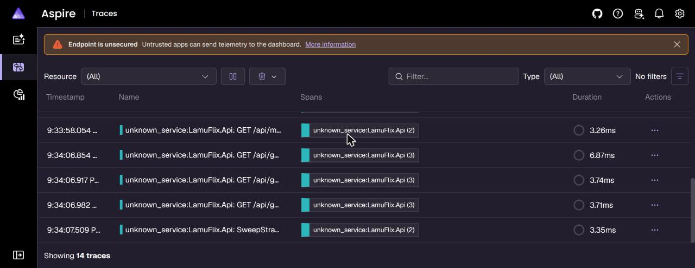

# LamuFlix

[](https://github.com/lamuniercosta/lamuflix/actions/workflows/ci.yml)

LamuFlix is a media management and playback application modernization project.

## Modernization to .NET 10

### DEV-14: Web, Data, and Test Upgrade
The Web and Data projects—as well as the test suite (`LamuFlix.Test`)—have been upgraded from .NET Core 2.1 to **.NET 10 (`net10.0`)**.

Notable changes:
- Target frameworks upgraded to `net10.0`.
- Removed explicit `Microsoft.AspNetCore.App` metapackage reference (now implicit in `Microsoft.NET.Sdk.Web`).
- Migrated from `IHostingEnvironment` to `IWebHostEnvironment`.
- Upgraded `Pomelo.EntityFrameworkCore.MySql` to `9.0.0` with explicit server versioning (`MySqlServerVersion`).
- Replaced legacy `UseMvc` with modern endpoint routing (`UseRouting`, `UseAuthorization`, `UseEndpoints`) and `AddControllersWithViews()`.
- Modernized MSTest and EF Core In-Memory test dependencies.

### DEV-15: Worker BackgroundService
The legacy .NET Framework 4.6.1 WinForms worker in `LamuFlix.Work` has been replaced with a modern headless **.NET 10 `BackgroundService`** (`QueueWorker`):
- Deleted legacy WinForms UI artifacts (`Form1.cs`, `Form1.Designer.cs`, `Form1.resx`, `App.config`, `Properties/Resources.*`, `Properties/Settings.*`, `packages.config`).
- Upgraded `LamuFlix.Worker.csproj` to SDK-style project (`Microsoft.NET.Sdk.Worker`) targeting `net10.0` with nullable reference types enabled.
- Replaced the WinForms loop with an asynchronous hosted service consuming from RabbitMQ (`task_queue`) via `EventingBasicConsumer` with graceful shutdown support.
- Configured generic hosting with `Host.CreateDefaultBuilder` and `appsettings.json`.
- Added unit tests for `QueueWorker` in `LamuFlix.Test`.
- The entire solution (`LamuFlix.sln`) now compiles with zero errors on .NET 10.

---

## Verification & Building
To build the complete solution and run tests:
```bash
dotnet build LamuFlix.sln
dotnet test
```

## Run with Docker Compose

Copy both example files and replace their placeholders with local values. `.env` supplies the Postgres and RabbitMQ container initialization credentials and can set an optional host library path. `docker/api.settings.json` configures the API; its database and RabbitMQ credentials must match the corresponding values in `.env`. Put the OMDb key in the JSON file. The secret-bearing JSON file is ignored by Git and excluded from the Docker build context.

```bash
cp .env.example .env
cp docker/api.settings.example.json docker/api.settings.json
docker compose up -d --build
```

Applying changes to `docker/api.settings.json` requires restarting the API because some options are read at startup. Open http://localhost:3000. To mount a different library directory, set `LIBRARY_PATH` in `.env` before starting (defaults to `./docker/sample-library`).

## Observability

Traces, metrics, and logs from the Api (including its background workers) export over OTLP. For local viewing, start the Aspire Dashboard:

```bash
docker compose -f docker-compose.observability.yml up -d
```

- Dashboard UI: http://localhost:18888
- OTLP gRPC: `localhost:4317`, OTLP HTTP: `localhost:4318`

The Api exports to `http://localhost:4317` by default. To send telemetry elsewhere, set `OTEL_EXPORTER_OTLP_ENDPOINT`.

The dashboard runs unsecured for local use only. Do not expose ports 18888, 4317, or 4318 beyond localhost.



## Local .NET tools

The repository pins three local tools in `.config/dotnet-tools.json` (`isRoot: true`). The manifest version pins each tool to the exact release listed; each entry also sets `rollForward: false`.

| Package | Pinned version | Command |
|---|---|---|
| `jetbrains.resharper.globaltools` | 2026.1.3 | `jb` |
| `dotnet-stryker` | 5.0.0 | `dotnet-stryker` |
| `dotnet-ef` | 9.0.0 | `dotnet-ef` |

**Purpose**

- **`jb`:** ReSharper InspectCode, used by `./scripts/run-jetbrains-inspectcode.ps1`.
- **`dotnet-stryker`:** Mutation testing via `./scripts/run-mutation.ps1` (`-Project <name>` narrows it; reports go to an output root outside the repo, which the gate prints).
- **`dotnet-ef`:** EF Core design-time CLI only (not part of the running app). It is pinned at 9.0.0 for the .NET 10 / EF Core 9.0 stack (DEV-360).

**Restore**

From the worktree root (each worktree restores independently):

```bash
dotnet tool restore
```

Exit `0` means the pinned tools are available. A non-zero exit means restore failed; when the cause is a pinned version being unavailable, no fallback version is installed.

**Usage**

- InspectCode: `./scripts/run-jetbrains-inspectcode.ps1` (the script runs `dotnet tool restore` and invokes `jb`). If `jb` is not wired, that gate exits `1`.
- Mutation testing from repo/worktree root: `pwsh -NoProfile -File ./scripts/run-mutation.ps1`
- EF Core design-time: `dotnet tool run dotnet-ef` or `dotnet-ef`

**Update**

Change a pin only with an explicit version, then verify `.config/dotnet-tools.json`:

```bash
dotnet tool update <package-id> --version <version>
```

Do not use `dotnet tool update --all` to refresh these pins: that command ignores `rollForward: false` and can move the manifest off the versions above.

**Troubleshooting**

- After clone or in a new worktree, run `dotnet tool restore` before the InspectCode gate or other local-tool commands.
- If a pinned version is unavailable, `dotnet tool restore` fails with exit `1` and does not install a different version.
- Restoring a reverted manifest in git does not by itself replace tools already cached at other versions. Uninstall the local tool, then `dotnet tool restore`, so the cache matches the pins.
- Confirm the running pins with `dotnet tool list --local`; they must match the table above.
