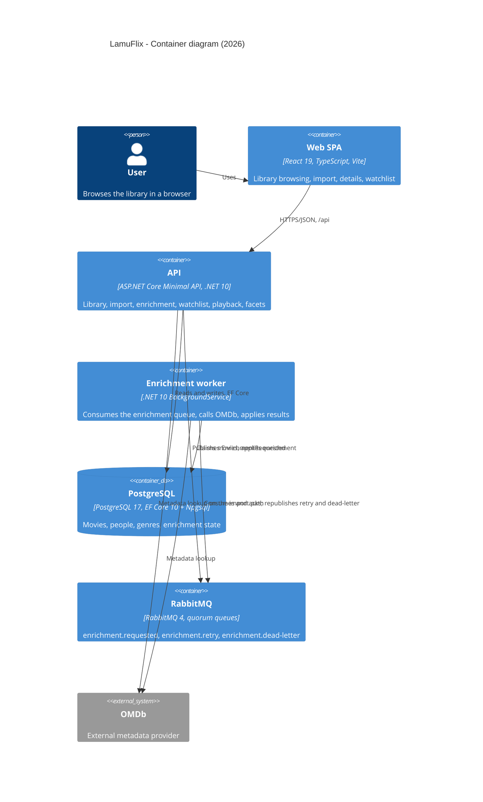

# LamuFlix

[](https://github.com/lamuniercosta/lamuflix/actions/workflows/ci.yml)

LamuFlix is a personal streaming and media library platform. It scans a local movie library, enriches each title with metadata from OMDb, and serves browsing, watchlist, and playback through a React single-page application backed by a .NET API.

This README describes the **2018 to 2026 modernization**: where the codebase started, where it is now, how the pieces fit together, and how to run and verify it.

## Modernization (2018 → 2026)

The original stack was .NET Framework / .NET Core 2.1 with a WinForms worker, MySQL persistence, and server-rendered MVC. The modern stack is **.NET 10** with a headless worker, PostgreSQL, a Minimal API, and a React SPA. Each row below names the decision record behind it.

| Before | After | Decided in |
|---|---|---|
| WinForms worker (`LamuFlix.Work`, .NET Framework 4.6.1) with a UI message loop | Headless .NET 10 `BackgroundService` (`QueueWorker`) consuming from RabbitMQ with graceful shutdown | [ADR-0004](docs/adr/ADR-0004.md) |
| MySQL via Pomelo, anemic models, MySQL-specific migrations, hard-coded connection string | PostgreSQL 16+ via Npgsql on EF Core 10, per-entity configurations, one fresh `Initial` migration, no data migration from MySQL | [ADR-0003](docs/adr/ADR-0003.md) |
| Reflection-based filtering and sorting (`DynamicQuery<T>`, `DynamicSort<T>`); unknown sort names threw, nullable titles sorted nulls first | Typed `MovieQuery` record with closed `MovieSort` / `SortDirection` SmartEnums, validated page ranges, `NULLS LAST` in both directions | [ADR-0009](docs/adr/ADR-0009.md) |
| `UseMvc` with an explicit `Microsoft.AspNetCore.App` metapackage and `IHostingEnvironment` | Minimal API on .NET 10 (`UseRouting`, `UseAuthorization`, endpoint routing, `AddControllersWithViews`) plus a React 19 / TypeScript / Vite SPA with a generated OpenAPI → TypeScript contract | [ADR-0007](docs/adr/ADR-0007.md) |
| Classic `task_queue` / `task_queue_dlq` with a connection per publish, no confirms, no retry delay | One `lamuflix.enrichment` exchange with three durable quorum queues (`enrichment.requested`, `enrichment.retry` with TTL, `enrichment.dead-letter`), publisher confirms with mandatory routing, and a sweeper for stranded work | [ADR-0004](docs/adr/ADR-0004.md), [ADR-0005](docs/adr/ADR-0005.md) |

Cross-cutting rules that hold across the whole modernization: explicit handlers with hand-wired decorators instead of MediatR ([ADR-0002](docs/adr/ADR-0002.md)), ports and adapters with a feature-organised core ([ADR-0001](docs/adr/ADR-0001.md)), caller-safe failure categories with raw errors kept in logs ([ADR-0006](docs/adr/ADR-0006.md)), `TimeProvider` for time with `DateTime.Now` failing the build, xUnit v3 only, and Testcontainers instead of mocked infrastructure ([ADR-0010](docs/adr/ADR-0010.md)).

## Architecture

C4 container view. The six boxes below are the whole runtime: the ticket's Web SPA, API, Worker, PostgreSQL, RabbitMQ, and OMDb.



How enrichment flows: the API persists a movie as `Pending` and publishes `EnrichmentRequested`. The worker opens a scope per message, claims the movie (`TryClaimForEnrichmentAsync`), calls the metadata provider, and applies the result — or classifies the failure and follows the single Core retry policy (`Retry`, `RetryDelayed` through the TTL queue, `DeadLetter`). Both the claim lease and the retry delay keep a redelivered message from being refused and lost; a periodic sweeper re-enqueues stranded `Pending` movies ([ADR-0005](docs/adr/ADR-0005.md)). Trace context (`traceparent`, plus `tracestate` when present) propagates in message headers from publisher to consumer span.

## Run with Docker Compose

Copy both example files and replace their placeholders with local values. `.env` supplies the Postgres and RabbitMQ container initialization credentials and can set an optional host library path. `docker/api.settings.json` configures the API; its database and RabbitMQ credentials must match the corresponding values in `.env`. Put the OMDb key in the JSON file. The secret-bearing JSON file is ignored by Git and excluded from the Docker build context.

```bash
cp .env.example .env
cp docker/api.settings.example.json docker/api.settings.json
docker compose up -d --build
```

Applying changes to `docker/api.settings.json` requires restarting the API because some options are read at startup. Open http://localhost:3000. To mount a different library directory, set `LIBRARY_PATH` in `.env` before starting (defaults to `./docker/sample-library`).

## Verification & Building

To build the complete solution and run tests:

```bash
dotnet build LamuFlix.sln
dotnet test
```

Every gate below must pass before a PR merges. The scripts accept `-Help`; the analyzer gates take `-BaseRef`, `-Files`, and `-All`.

| Gate | Command |
|---|---|
| Roslyn analyzers (warnings are errors) | `./scripts/run-roslyn-analyzers.ps1` |
| Cyclomatic complexity (implement 15 / refactor 6) | `./scripts/run-cyclomatic-complexity.ps1` |
| InspectCode duplication check | `./scripts/run-jetbrains-inspectcode.ps1` |
| Unit + integration tests (xUnit v3) | `dotnet test` |
| Property tests (FsCheck) | `./scripts/run-property-tests.ps1` |
| Mutation testing (Stryker, threshold 80%) | `pwsh -NoProfile -File ./scripts/run-mutation.ps1` |
| Vulnerable packages | `./scripts/run-vulnerable-packages.ps1` |
| Format | `dotnet format --verify-no-changes` |
| Web lint, typecheck, test, build, OpenAPI drift | `npm run lint`, `npx tsc --noEmit`, `npm test`, `npm run build` (in `web/`) |

The contract chain is C# DTO → OpenAPI (`web/src/api/openapi.json`, the sole authoritative baseline, never hand-edited) → generated TypeScript (`web/src/api/types.ts`). CI fails on drift; intentional regeneration is an explicitly enabled local path documented in [ADR-0007](docs/adr/ADR-0007.md).

## Observability

Traces, metrics, and logs from the Api (including its background workers) export over OTLP. For local viewing, start the Aspire Dashboard:

```bash
docker compose -f docker-compose.observability.yml up -d
```

- Dashboard UI: http://localhost:18888
- OTLP gRPC: `localhost:4317`, OTLP HTTP: `localhost:4318`

The Api exports to `http://localhost:4317` by default. To send telemetry elsewhere, set `OTEL_EXPORTER_OTLP_ENDPOINT`.

The dashboard runs unsecured for local use only. Do not expose ports 18888, 4317, or 4318 beyond localhost.


Composition lives in `LamuFlix.ServiceDefaults`; see [0018](docs/adr/0018-observability-composition-in-service-defaults.md).

## Architecture decisions

All decisions live in `docs/adr/`:

- [ADR-0001](docs/adr/ADR-0001.md) — Ports and adapters with a feature-organised core
- [ADR-0002](docs/adr/ADR-0002.md) — Explicit handlers and decorators instead of MediatR
- [ADR-0003](docs/adr/ADR-0003.md) — PostgreSQL persistence with a single fresh migration
- [ADR-0004](docs/adr/ADR-0004.md) — Enrichment messaging topology: quorum queues, TTL retry queue, dead-letter queue
- [ADR-0005](docs/adr/ADR-0005.md) — Dual-write mitigation: sweeper now, transactional outbox as a stretch
- [ADR-0006](docs/adr/ADR-0006.md) — Failure categories separated from exception types
- [ADR-0007](docs/adr/ADR-0007.md) — Runtime OpenAPI contract with Development-only Scalar and fail-closed drift proof
- [ADR-0008](docs/adr/ADR-0008.md) — Polling for enrichment status in P1; SignalR deferred
- [ADR-0009](docs/adr/ADR-0009.md) — Typed movie query and sort
- [ADR-0010](docs/adr/ADR-0010.md) — TimeProvider, BannedSymbols, xUnit v3, and Testcontainers
- [0013](docs/adr/0013-src-tests-solution-layout.md) — Solution layout: src/ and tests/
- [0014](docs/adr/0014-core-movie-aggregate-separate-from-ef-entity.md) — Core Movie aggregate, separate from the EF entity
- [0015](docs/adr/0015-handler-pipeline-placement.md) — Handler pipeline: contracts in Core, decorators in Infrastructure
- [0016](docs/adr/0016-stryker-mtp-runner.md) — Mutation gate runs Stryker 5 on the Microsoft Testing Platform runner
- [0017](docs/adr/0017-enrichment-decisions-in-core-handlers.md) — Enrichment decisions in Core handlers; transport in the consumer
- [0018](docs/adr/0018-observability-composition-in-service-defaults.md) — Observability composition in ServiceDefaults
- [0019](docs/adr/0019-infrastructure-consumer-delivery-proof.md) — Infrastructure consumer delivery proof
- [0020](docs/adr/0020-request-correlated-import-enrichment-proof.md) — Request-correlated import enrichment proof

Product direction is set by [`specs/PRODUCT.md`](specs/PRODUCT.md); shared vocabulary lives in [`CONTEXT.md`](CONTEXT.md).

## Local .NET tools

The repository pins three local tools in `.config/dotnet-tools.json` (`isRoot: true`). The manifest version pins each tool to the exact release listed; each entry also sets `rollForward: false`.

| Package | Pinned version | Command |
|---|---|---|
| `jetbrains.resharper.globaltools` | 2026.1.5.2 | `jb` |
| `dotnet-stryker` | 5.0.0 | `dotnet-stryker` |
| `dotnet-ef` | 10.0.13 | `dotnet-ef` |

**Purpose**

- **`jb`:** ReSharper InspectCode, used by `./scripts/run-jetbrains-inspectcode.ps1`.
- **`dotnet-stryker`:** Mutation testing via `./scripts/run-mutation.ps1` (`-Project <name>` narrows it; reports go to an output root outside the repo, which the gate prints).
- **`dotnet-ef`:** EF Core design-time CLI only (not part of the running app). It tracks the .NET 10 / EF Core 10 stack.

**Restore**

From the worktree root (each worktree restores independently):

```bash
dotnet tool restore
```

Exit `0` means the pinned tools are available. A non-zero exit means restore failed; when the cause is a pinned version being unavailable, no fallback version is installed.

**Usage**

- InspectCode: `./scripts/run-jetbrains-inspectcode.ps1` (the script runs `dotnet tool restore` and invokes `jb`). If `jb` is not wired, that gate exits `1`.
- Mutation testing from repo/worktree root: `pwsh -NoProfile -File ./scripts/run-mutation.ps1`
- EF Core design-time: `dotnet tool run dotnet-ef` or `dotnet-ef`

**Update**

Change a pin only with an explicit version, then verify `.config/dotnet-tools.json`:

```bash
dotnet tool update <package-id> --version <version>
```

Do not use `dotnet tool update --all` to refresh these pins: that command ignores `rollForward: false` and can move the manifest off the versions above.

**Troubleshooting**

- After clone or in a new worktree, run `dotnet tool restore` before the InspectCode gate or other local-tool commands.
- If a pinned version is unavailable, `dotnet tool restore` fails with exit `1` and does not install a different version.
- Restoring a reverted manifest in git does not by itself replace tools already cached at other versions. Uninstall the local tool, then `dotnet tool restore`, so the cache matches the pins.
- Confirm the running pins with `dotnet tool list --local`; they must match the table above.
