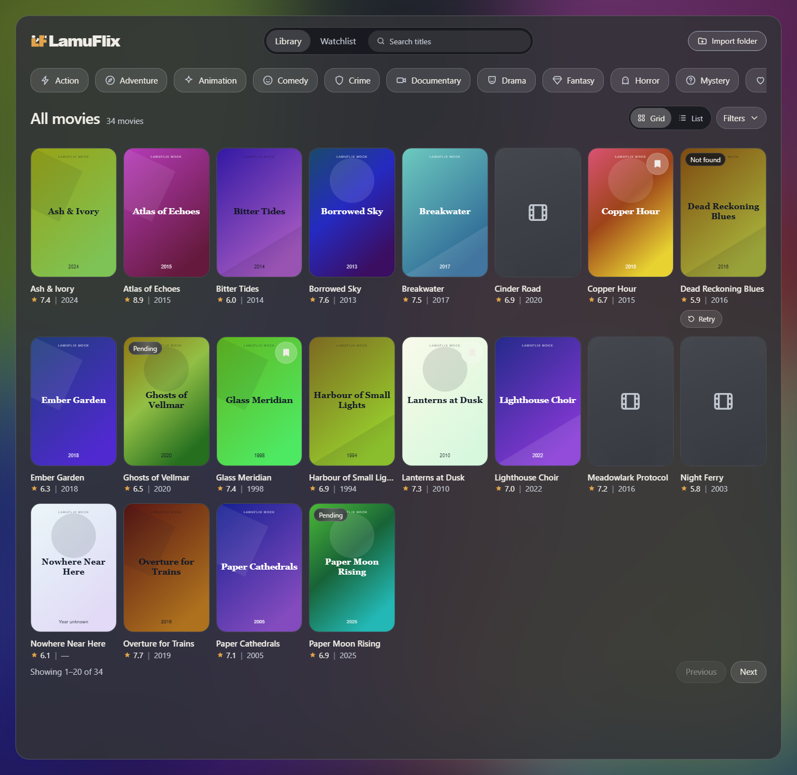
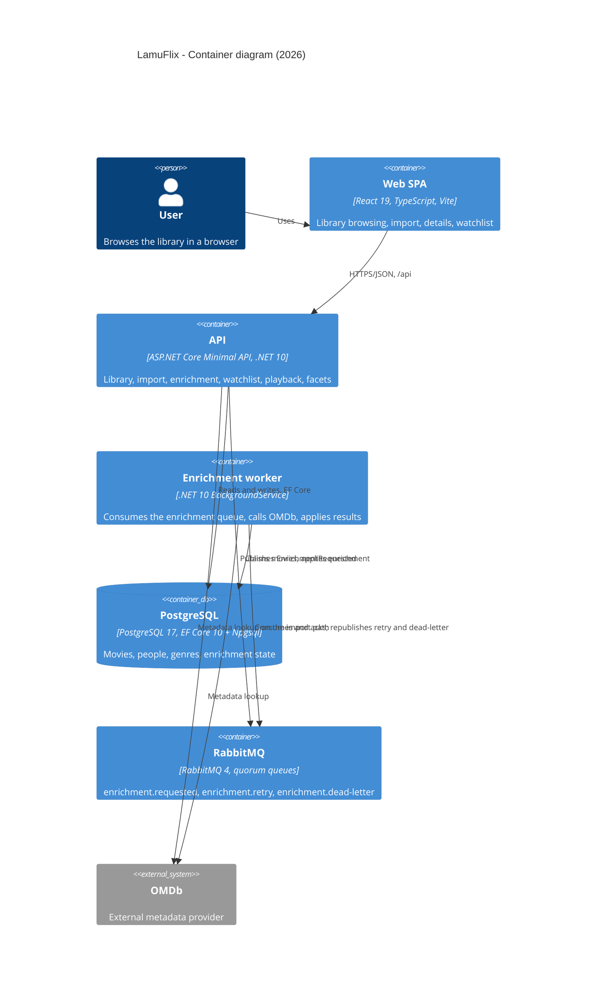
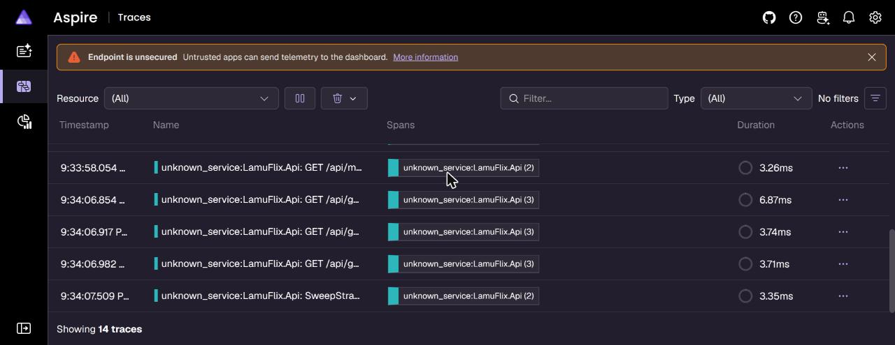

# LamuFlix

[](https://github.com/lamuniercosta/lamuflix/actions/workflows/ci.yml)

LamuFlix is a personal streaming and media library platform. It scans a local movie library, enriches each title with metadata from OMDb, and serves browsing, watchlist, and playback through a React single-page application backed by a .NET API.



Library view with synthetic sample data.

This README describes the **2018 to 2026 modernization**: where the codebase started, where it is now, how the pieces fit together, and how to run and verify it.

## Modernization (2018 → 2026)

The original stack was .NET Framework / .NET Core 2.1 with a WinForms worker, MySQL persistence, and server-rendered MVC. The modern stack is **.NET 10** with a headless worker, PostgreSQL, a Minimal API, and a React SPA. Each row below names the decision record behind it.

| Before | After | Decided in |
|---|---|---|
| WinForms worker (`LamuFlix.Work`, .NET Framework 4.6.1) with a UI message loop | Headless .NET 10 `BackgroundService` (`QueueWorker`) consuming from RabbitMQ with graceful shutdown | [ADR-0004](docs/adr/ADR-0004.md) |
| MySQL via Pomelo, anemic models, MySQL-specific migrations, hard-coded connection string | PostgreSQL 16+ via Npgsql on EF Core 10, per-entity configurations, one fresh `Initial` migration, no data migration from MySQL | [ADR-0003](docs/adr/ADR-0003.md) |
| Reflection-based filtering and sorting (`DynamicQuery<T>`, `DynamicSort<T>`); unknown sort names threw, nullable titles sorted nulls first | Typed `MovieQuery` record with closed `MovieSort` / `SortDirection` SmartEnums, validated page ranges, `NULLS LAST` in both directions | [ADR-0009](docs/adr/ADR-0009.md) |
| `UseMvc` with an explicit `Microsoft.AspNetCore.App` metapackage and `IHostingEnvironment` | Minimal API on .NET 10 (`UseRouting`, `UseAuthorization`, endpoint routing, `AddControllersWithViews`) plus a React 19 / TypeScript / Vite SPA with a generated OpenAPI → TypeScript contract | [ADR-0007](docs/adr/ADR-0007.md) |
| Classic `task_queue` / `task_queue_dlq` with a connection per publish, no confirms, no retry delay | One `lamuflix.enrichment` exchange with three durable quorum queues (`enrichment.requested`, `enrichment.retry` with TTL, `enrichment.dead-letter`), publisher confirms with mandatory routing, and a sweeper for stranded work | [ADR-0004](docs/adr/ADR-0004.md), [ADR-0005](docs/adr/ADR-0005.md) |

Cross-cutting rules that hold across the whole modernization: explicit handlers with hand-wired decorators instead of MediatR ([ADR-0002](docs/adr/ADR-0002.md)), ports and adapters with a feature-organised core ([ADR-0001](docs/adr/ADR-0001.md)), caller-safe failure categories with raw errors kept in logs ([ADR-0006](docs/adr/ADR-0006.md)), `TimeProvider` for time with `DateTime.Now` failing the build, xUnit v3 only, and Testcontainers instead of mocked infrastructure ([ADR-0010](docs/adr/ADR-0010.md)).

## Architecture

C4 container view. The six boxes below are the whole runtime: the ticket's Web SPA, API, Worker, PostgreSQL, RabbitMQ, and OMDb.



How enrichment flows: the API persists a movie as `Pending` and publishes `EnrichmentRequested`. The worker opens a scope per message, claims the movie (`TryClaimForEnrichmentAsync`), calls the metadata provider, and applies the result — or classifies the failure and follows the single Core retry policy (`Retry`, `RetryDelayed` through the TTL queue, `DeadLetter`). Both the claim lease and the retry delay keep a redelivered message from being refused and lost; a periodic sweeper re-enqueues stranded `Pending` movies ([ADR-0005](docs/adr/ADR-0005.md)). Trace context (`traceparent`, plus `tracestate` when present) propagates in message headers from publisher to consumer span.

## Run with Docker Compose

Copy both example files and replace their placeholders with local values. `.env` supplies the Postgres and RabbitMQ container initialization credentials, can set an optional host library path, and carries the TMDb enablement flag and API key. `docker/api.settings.json` configures the API; its database and RabbitMQ credentials must match the corresponding values in `.env`. Put the OMDb key in the JSON file. The secret-bearing JSON file is ignored by Git and excluded from the Docker build context.

```bash
cp .env.example .env
cp docker/api.settings.example.json docker/api.settings.json
docker compose up -d --build
```

Applying changes to `docker/api.settings.json` requires restarting the API because some options are read at startup. Open http://localhost:3000. To mount a different library directory, set `LIBRARY_PATH` in `.env` before starting (defaults to `./docker/sample-library`). Imports take the movie folder name relative to the library root (for example `2 Days in New York[2012]`), and full paths still work.

The header's `Bulk import` action lists every folder under the root that is not yet imported, plus a loose video file sitting directly in the root, and imports the selection or all of it in one pass; already-imported folders are skipped, so repeating the pass is safe. It is backed by `GET /api/movies/import/candidates` (`newFolders`) and `POST /api/movies/import/library` (`folders`, `retryFailed`), which returns `imported`, `skipped`, `retried` counts and per-folder `failures` with a closed reason code (`folder-not-found`, `no-video`, `invalid-folder`, `import-failed`) — one folder never aborts the rest. `retryFailed` also requeues movies stuck in Failed enrichment. `POST /api/movies/import` remains the single-folder call.

`LIBRARY_PATH` changes the mount; keep it consistent with `Library:RootPath` (`/media/library` inside the container) and add the old mount to `Library:LegacyRootPaths` when an existing catalog was seeded from a different location. On an existing catalog, stop the API before upgrading and read [Operating a library-relative upgrade](#operating-a-library-relative-upgrade) first.

### TMDb collection membership

TMDb supplements an OMDb hit with keywords, full cast, and collection membership, so the library's Collection filter needs a TMDb API key. Compose enables TMDb by default (`Tmdb__Enabled: ${TMDB_ENABLED:-true}`) and reads the key from `${TMDB_API_KEY:-}`, so a `.env` that only adds a key is enough:

```bash
# in .env (ignored by Git; never commit a real key)
TMDB_ENABLED=true
TMDB_API_KEY=your-local-key
docker compose up -d
```

`docker compose up -d` recreates the API container so changed `.env` values take effect. Both TMDb settings live only in the ignored `.env` file — that is the TMDb secret channel, separate from the OMDb key in the ignored `docker/api.settings.json`. Never commit credentials, and nothing is baked into the image.

Without a TMDb key, leave `TMDB_ENABLED=false`. With TMDb enabled and a blank key, the app sends no TMDb request, but an OMDb miss becomes a retryable "provider unavailable" failure instead of a plain not-found, so OMDb-only `NotFound` behavior requires explicitly setting `TMDB_ENABLED=false` until a real key is configured. Outside Compose the API keeps `Tmdb.Enabled: false` in `appsettings.json`, so a plain `dotnet run` never calls TMDb unless you opt in through configuration.

## Windows daily-driver setup

The daily-driver host runs the Api and the Vite dev server as Windows processes while Postgres and RabbitMQ run as durable containers from `docker-compose.daily-driver.yml`. The host keeps its containers — and its catalog — across restarts, unlike the disposable AppHost. This is a third entrypoint next to the full Compose stack above and the AppHost: **run one entrypoint at a time**.

### Prerequisites

| Requirement | Details |
|---|---|
| .NET SDK | `10.0.401` with `rollForward: latestPatch`, per `global.json`. |
| Node.js | `>=24 <25` on `PATH`, per `web/package.json` `engines`. Run `npm install` in `web/` once, and after dependency changes. |
| Container runtime | Docker Desktop or Podman, running. Only Postgres and RabbitMQ are containerised here; the Api, the SPA, and Ollama all run on the host. |
| Ollama on the host | Installed from the official Windows installer, listening on `http://localhost:11434` with `all-minilm` pulled. See [Host Ollama on Windows](#host-ollama-on-windows). |
| Local values | Database and broker credentials, ports, library root, OMDb key, and optionally a player executable. All of them are yours: none is committed, and none has a working committed default. |

### Configure

The daily-driver Compose file and the host Api read **two separate local channels**. Both hold machine-specific values; neither is committed.

1. **Compose operator channel** — container initialization credentials for the daily-driver project. `docker-compose.daily-driver.yml` references `POSTGRES_USER`, `POSTGRES_PASSWORD`, `RABBITMQ_USER`, and `RABBITMQ_PASSWORD` fail-closed, so those four have no default and rendering fails without them. Supply them through your process environment or an untracked local Compose configuration channel (the Git-ignored `.env` in the repository root, or `docker compose --env-file <ignored file>`). Do not add them to a tracked file.
2. **Api local settings channel** — the Api's own configuration: the Api user-secrets store (`dotnet user-secrets`) or an ignored local development settings file. This channel is not the Compose channel, even where the values must agree.

The Compose file's optional `POSTGRES_PORT` (default `5432`) and `RABBITMQ_PORT` (default `5672`) publish on `127.0.0.1` only.

```powershell
# Compose operator channel: process environment, this shell only
$env:POSTGRES_USER = '<local postgres user>'
$env:POSTGRES_PASSWORD = '<local postgres password>'
$env:RABBITMQ_USER = '<local rabbitmq user>'
$env:RABBITMQ_PASSWORD = '<local rabbitmq password>'
```

```powershell
# Api local settings channel: user secrets, never committed
dotnet user-secrets set "ConnectionStrings:DefaultConnection" "Host=localhost;Port=5432;Database=lamuflix;Username=<local postgres user>;Password=<local postgres password>" --project src/LamuFlix.Api
dotnet user-secrets set "RabbitMq:HostName" "localhost" --project src/LamuFlix.Api
dotnet user-secrets set "RabbitMq:Port" "5672" --project src/LamuFlix.Api
dotnet user-secrets set "RabbitMq:UserName" "<local rabbitmq user>" --project src/LamuFlix.Api
dotnet user-secrets set "RabbitMq:Password" "<local rabbitmq password>" --project src/LamuFlix.Api
dotnet user-secrets set "Library:RootPath" "<absolute path to your movie library>" --project src/LamuFlix.Api
dotnet user-secrets set "Omdb:ApiKey" "<your OMDb API key>" --project src/LamuFlix.Api
dotnet user-secrets set "Database:ApplyMigrationsOnStartup" "true" --project src/LamuFlix.Api
```

`Database:ApplyMigrationsOnStartup` defaults to `false` outside Compose, so set it to `true` for the first host start (or apply the migrations yourself); with it `false` on a catalog that was never migrated, the startup library-path gate fails closed with "Schema not ready". `Library:RootPath` must be an absolute Windows path; if your catalog was seeded under a different root, read [Operating a library-relative upgrade](#operating-a-library-relative-upgrade) before starting.

The daily-driver project is `lamuflix-daily-driver`, with named volumes `postgres-data` and `rabbitmq-data` that Compose materialises as `lamuflix-daily-driver_postgres-data` and `lamuflix-daily-driver_rabbitmq-data`. Full Compose and the AppHost use different Compose projects and different ports, so their data is neither shared nor migrated between entrypoints.

### Start

Start the containers, then Ollama and its model, then the Api, then the SPA — the Api's embedding startup validation runs as part of host startup and aborts it when the probe fails (see [Host Ollama on Windows](#host-ollama-on-windows)).

```powershell
docker compose -f docker-compose.daily-driver.yml up -d
docker compose -f docker-compose.daily-driver.yml ps
$env:ASPNETCORE_ENVIRONMENT = 'Development'
dotnet run --project src/LamuFlix.Api
```

`Development` is required for the user-secrets channel to load: the repository has no launch profile, so `dotnet run` defaults to `Production` and would read neither user secrets nor the Development-only OpenAPI and Scalar endpoints. The Api then listens on `http://localhost:5000`. In a second shell:

```powershell
cd web
$env:VITE_API_BASE_URL = 'http://localhost:5000'
npm run dev
```

The SPA is served at `http://localhost:5173`; the Api CORS policy allows exactly that development origin.

### Verify

```powershell
docker compose -f docker-compose.daily-driver.yml ps
Invoke-RestMethod http://localhost:5000/health/ready
```

- Both containers report `healthy`, and the rendered topology is only `postgres` and `rabbitmq` (check with `docker compose -f docker-compose.daily-driver.yml config`).
- `/health/ready` returns `200` with the readiness-tagged checks — database, broker, outbox relay, and hosted consumers. It aggregates readiness-tagged checks only, so it is **not** the Ollama probe; see [Host Ollama on Windows](#host-ollama-on-windows) for that proof.
- The Api process answers `/health/ready`, which means its embedding startup validation already completed successfully: a failed probe stops the process instead of starting the listener.
- The library browser loads at `http://localhost:5173` and lists movies from your configured root.

### Stop

Stopping and resetting are different operations.

| Task | Command | Data |
|---|---|---|
| Stop the host processes | `Ctrl+C` in each shell | Nothing touched |
| Stop the containers, keep them and their volumes | `docker compose -f docker-compose.daily-driver.yml stop` | Kept |
| Remove containers and the network, keep the named volumes | `docker compose -f docker-compose.daily-driver.yml down` | Kept — an ordinary restart keeps your catalog and broker state |
| Destructive reset of this project only | `docker compose -f docker-compose.daily-driver.yml down -v` | Deletes `postgres-data` and `rabbitmq-data` for `lamuflix-daily-driver` only |

`down -v` is project-scoped, so it cannot touch the full Compose stack or the AppHost, and it is never part of routine startup. Use it only when you intend to discard the daily-driver catalog and broker state.

### Troubleshoot

- **Port collision.** A host Postgres, RabbitMQ, or another entrypoint can already hold `5432` or `5672`. Check with `Get-NetTCPConnection -LocalPort 5432,5672 -ErrorAction SilentlyContinue`, then either stop the other owner or set `POSTGRES_PORT` / `RABBITMQ_PORT` in the Compose operator channel and point the Api connection string at the new port.
- **One entrypoint at a time.** Running the full Compose stack, the AppHost, and the daily-driver project together invites port and credential confusion. Stop one before starting another; they share no state.
- **Credentials do not match.** `docker compose config` failing on a missing variable means the Compose operator channel is empty in that shell. A running Api that cannot reach Postgres or RabbitMQ usually means the Api local settings channel and the Compose channel disagree.
- **Volumes look gone after `down`.** `down` without `-v` keeps named volumes; `down -v` does not. `docker volume ls` shows the project-scoped volumes.
- **Durability versus upgrades.** Restarting or recreating the *same* container images with volumes retained keeps your state, and that is what this runbook asks you to verify. It does **not** certify an image upgrade: changing an image tag or digest is a separate, deliberate decision. The daily-driver file keeps the current `rabbitmq:4-alpine` tag and the pinned Postgres digest; a digest change is not authorised silently by a successful restart.
- **Ollama symptoms.** See the diagnostics table in [Host Ollama on Windows](#host-ollama-on-windows).

### Host Ollama on Windows

Install from the official Windows installer — [OllamaSetup.exe](https://ollama.com/download/OllamaSetup.exe), documented at [docs.ollama.com/windows](https://docs.ollama.com/windows). Do not substitute winget, downloaded install scripts, or another service manager. Open the installed background app; it listens on `http://localhost:11434`, which matches the Api's `Ollama:Endpoint` default.

Run these commands on the Windows host, not with `docker compose exec` — the daily-driver file runs no Ollama service, so a container step would not prove the host prerequisite:

```powershell
ollama pull all-minilm
ollama show all-minilm
ollama list
```

Start the Api only after `all-minilm` appears in `ollama show` / `ollama list`. The Api runs a real embedding startup validation: it requests one finite 384-dimension embedding before its HTTP listener binds and exits when the probe fails. A visible model is therefore a prerequisite, not a proof — only a running Api that answers `/health/ready` proves the host Ollama path works. `ollama list` alone, and `/health/ready` alone, are both insufficient.

Distinct diagnostics — a listener problem, a model problem, and a probe-shape problem read differently:

| Symptom | Kind | Meaning |
|---|---|---|
| `Ollama embedding startup verification failed at http://localhost:11434 ... provider_unavailable` | Listener | Nothing is listening at the configured endpoint: the background app is not running, or `Ollama:Endpoint` names the wrong host or port. |
| `... invalid_response` after the endpoint answers | Model | The server answered but not usefully — most often the model is not pulled. Run `ollama pull all-minilm` and start the Api again. |
| `The embedding startup probe did not return exactly one finite 384-dimension vector.` | Startup failure | The model answered in the wrong shape; confirm with `ollama show all-minilm` that you pulled the intended embedding model and that `Ollama:ModelName` matches it. |

### Local playback example (optional)

LocalPlay is off in Compose (`docker/api.settings.example.json` ships `"LocalPlay": false`), and nothing in this ticket ships an enabled default. Enabling it is an explicit host-only opt-in in the **Api local settings channel** (user secrets or ignored local settings), never in a tracked file.

The delivered boundary is fail-closed, so confirm loopback binding **before** you enable LocalPlay:

- When `Features:LocalPlay` is `true`, the Api refuses to start unless every effective Kestrel listener is proven loopback. An unqualified `http://*:5000`, `http://0.0.0.0:5000`, or a non-loopback host name is refused at startup; `http://localhost:5000` is proven loopback.
- With LocalPlay enabled, a play request is refused unless the peer address is proven loopback and no `Forwarded` / `X-Forwarded-*` / `X-Real-IP` proxy headers are present.

Illustrative configuration with placeholders only — replace every placeholder locally and never commit the result:

```json
{
  "Features": {
    "LocalPlay": true
  },
  "Playback": {
    "Players": [
      {
        "Name": "Example Player",
        "ExecutablePath": "C:\\Path\\To\\Your\\Player\\player.exe",
        "Formats": ["mkv", "mp4"]
      }
    ]
  }
}
```

- `Name` is your label; `ExecutablePath` is an absolute path you discover locally; `Formats` are the top-level video extensions you want this player to open (`.mkv` and `mkv` are both accepted, and only listed extensions are mapped — an unlisted one is refused with a `422` validation error).
- Compose LocalPlay stays off. The playback proof runs against the existing gated endpoint, unchanged: `POST /api/movies/{id}/play` returns `204` on a successful launch, `403` when LocalPlay is disabled or the request is not proven local, and `422` when no configured player maps the file's extension.

## Ollama embedding model

Compose provisions Ollama with the embedding model the API needs for semantic search. `docker compose up` starts two Ollama services ([ADR-0025](docs/adr/ADR-0025-isolated-ollama-test.md)):

- `ollama` - the server, pinned by digest in `OLLAMA_IMAGE`, serving on the Compose network only. No host port is published.
- `ollama-model-init` - a one-shot initializer that pulls `OLLAMA_EMBEDDING_MODEL` (default `all-minilm`, which produces 384-dimensional vectors) and exits `0` only when the model is available.

Both share the named volume `ollama-models`, so a downloaded model survives `docker compose down` and restarts without re-downloading. Only a first run (or a removed volume) downloads the model; expect that first pull to take longer than a normal start.

**Health and readiness.** The `ollama` health check is model-aware: it reports healthy only when the server answers *and* the selected model is present (`ollama show "$OLLAMA_EMBEDDING_MODEL"`). The initializer starts as soon as the container is started (`service_started`), never waits for model-aware health before pulling, and enforces finite budgets while it does its own readiness wait and pull.

**Ollama does block Api boot.** The Api runs a real embedding startup validation before it binds its HTTP listener: it requests one finite 384-dimension embedding and, when the probe fails, logs the failure and exits instead of serving. On the first run, or after the `ollama-models` volume is removed, a slow model download therefore keeps the Api from starting until the model is available — start the initializer first (`docker compose up -d ollama ollama-model-init`) and wait for it to exit `0`. `/health/ready` covers readiness-tagged checks such as the database and broker; it is not the Ollama probe, so a green `/health/ready` never proves embeddings work.

**Settings.** All Ollama settings are non-secret and live in `.env` (see `.env.example`):

| Variable | Default | Meaning |
|---|---|---|
| `OLLAMA_IMAGE` | pinned `ollama/ollama:0.40.8@sha256:2b8eecdb...` | Image digest shared by both services and the opt-in test |
| `OLLAMA_EMBEDDING_MODEL` | `all-minilm` | Model pulled by the initializer; must produce 384 dimensions |
| `OLLAMA_READY_TIMEOUT_SECONDS` | `120` | Initializer budget for server readiness |
| `OLLAMA_PULL_TIMEOUT_SECONDS` | `900` | Initializer budget for the model pull |
| `OLLAMA_POLL_INTERVAL_SECONDS` | `2` | Initializer readiness poll interval |

Keep `OLLAMA_IMAGE` in sync between `docker-compose.yml`, `.env.example`, and `tests/LamuFlix.IntegrationTests/OllamaFixture.cs` when upgrading.

**Failure diagnosis.** A failed or interrupted initialization never reports model-ready health:

```bash
docker compose ps ollama ollama-model-init          # init should exit 0; ollama healthy
docker compose logs ollama-model-init               # explicit wait/pull failure reason
docker compose exec ollama ollama list              # confirm the model is present
```

The initializer exits non-zero with an actionable message when the model variable is empty, the server is not ready within `OLLAMA_READY_TIMEOUT_SECONDS`, or the pull exceeds `OLLAMA_PULL_TIMEOUT_SECONDS`. Re-run it with `docker compose up ollama-model-init --force-recreate`; to start from empty storage, remove the volume with `docker compose down -v`.

### Opt-in real-model test

The real-model proof runs through the DEV-412 embedding adapter against an isolated Testcontainers Ollama instance with fresh storage. It is tagged `Category=OllamaIntegration` and is skipped unless `LAMUFLIX_RUN_OLLAMA_TESTS=1` is set *before* any container is created, so plain `dotnet test` and default CI never start Ollama or download a model. With the opt-in set, Docker or model failures fail the test instead of skipping it:

```powershell
$env:LAMUFLIX_RUN_OLLAMA_TESTS = '1'
try {
    dotnet test tests/LamuFlix.IntegrationTests/LamuFlix.IntegrationTests.csproj --filter "Category=OllamaIntegration"
} finally {
    Remove-Item Env:LAMUFLIX_RUN_OLLAMA_TESTS -ErrorAction SilentlyContinue
}
```

CI excludes the category with `--filter "Category!=OllamaIntegration"` and sets no opt-in variable.

## Operating a library-relative upgrade

DEV-459 stores movie folders as canonical library-relative identities instead of deployment-specific absolute paths ([ADR 0035](docs/adr/0035-library-relative-movie-paths.md)). The upgrade rewrites stored paths, populates the derived `library_path_key` column, and activates its constraint once, at startup. Treat it as a coordinated maintenance window, not a rolling deploy.

### Shared library configuration

`Library:RootPath` and the optional `Library:LegacyRootPaths` are read by every Api instance and its hosted consumers, so all instances sharing a catalog must use the same values.

| Setting | Meaning |
|---|---|
| `Library:RootPath` | The active filesystem root for every runtime media read (playback, rescan, discovery, thumbnails) and the root new imports resolve under. Must be an absolute path. |
| `Library:LegacyRootPaths` | Optional array of absolute historical roots — Windows drive (`C:/library`), UNC (`//server/share/library`) or POSIX (`/media/library`) — recognized **only** while mapping already-stored absolute paths and already-queued thumbnail payloads. Entries never authorize a new import. |

`docker/api.settings.example.json` ships `"RootPath": "/media/library"` with an empty `LegacyRootPaths` array. Compose mounts `${LIBRARY_PATH:-./docker/sample-library}` at `/media/library`, so the default stack needs no alias. Outside Compose, set both values in the Api user-secrets store or `appsettings` — never in a committed file.

`LibraryOptionsValidator` runs at startup before the database gate opens a transaction. It rejects blank entries, relative entries that are not absolute roots, and any two aliases that overlap on a segment boundary, because one stored path could then map to two different identities. Its messages name the offending `Library:LegacyRootPaths[index]` and the corrective action.

The standard Docker alias `/media/library` is recognized automatically for backfill and for legacy thumbnail payloads **only when it maps a stored path unambiguously**. If it collides with a configured root or alias, startup fails closed instead of guessing. The alias never authorizes an import.

### Before you upgrade

1. **Hard-stop every old Api instance.** Stop all Api processes and containers before starting any upgraded one. An old writer cannot populate `library_path_key`, so a running mixed-version fleet fails the unique key constraint.
2. **Verify the fleet matches.** Every instance that will serve the catalog needs the same application version, the same .NET runtime, the same globalization mode (invariant vs. ICU), the same ICU/Unicode data version, and the same `Library:RootPath` / `Library:LegacyRootPaths`. The derived key is whole-string `ToUpperInvariant()`, so its values are runtime-bound: an instance running different Unicode data can derive different keys for the same stored path.
3. **Back up PostgreSQL.** Take a full pre-upgrade database backup. This backup is your only downgrade path (see below).
4. **Confirm the library is reachable.** The backfill does not check media existence, but reads after startup do; make sure the mount is present under the configured root.

### Startup behaviour

With `Database:ApplyMigrationsOnStartup` true, the Api applies the additive `AddLibraryPathKey` migration, then runs the library path gate, then starts listening. The gate takes `LOCK TABLE movies IN ACCESS EXCLUSIVE MODE` as the first statement of a single transaction, then validates the whole table, rewrites paths to canonical relative form, populates `library_path_key`, sets the column collation to `C` with `NOT NULL`, and creates `IX_movies_library_path_key` (non-concurrent). HTTP listeners and hosted consumers do no work until it succeeds. A failure rolls the whole transaction back and the process exits.

With `Database:ApplyMigrationsOnStartup` false, the gate only verifies the activated state — column present, `NOT NULL`, collated `C`, uniquely indexed — and fails closed with a "Schema not ready" message when it is not. It never migrates or activates in that mode.

A rerun on an already-migrated catalog is a no-op.

### Reading preflight failures

Startup failures are deliberate. Each message names the movie IDs involved and the reason:

| Message shape | Meaning and fix |
|---|---|
| `Movie ID <id> path '<stored>' matches no active, legacy, or default Docker library root.` | The stored absolute path sits under a root the configuration does not name. Add it to `Library:LegacyRootPaths` and restart. |
| `Movie ID <id> path '<stored>' maps ambiguously through '<a>', '<b>'.` | Two configured roots both contain the path. Remove one alias so the mapping is unique. |
| `Movie IDs <ids> map to the same library path key '<key>'.` | Rows collide once case-folded. Merge or remove the duplicates in the catalog before upgrading. |
| `Movie ID <id> has a malformed library path '<stored>'.` | The stored value is not a valid relative or absolute path. Repair the row. |
| `Schema not ready: ...` | Startup migrations are disabled but activation never ran. Start once with migrations enabled. |

Gate logs stay at Information level on success (`Library path gate activated ... after rewriting <n> row(s)`).

### Existing backstops (no new interlock)

Two protections exist and are documented here as the whole safety story — no additional pre-activation interlock is introduced:

- **Post-activation `NOT NULL`.** Once the column is `NOT NULL`, an old writer that never sets `library_path_key` cannot insert a row at all, so a stale instance fails loudly rather than writing a key-less movie.
- **Startup consistency check.** Each start recomputes the expected key for every row and fails closed if the stored key diverges, which surfaces a writer that bypassed the shared `SaveChanges` derivation.

### Alias retirement

`Library:LegacyRootPaths` exists for the migration window and the queue backlog. Retire it in this order:

1. Confirm the backfill is complete and the gate reports the activated schema.
2. Drain enrichment, retry and dead-letter queues so no queued payload still carries an absolute `FilePath`. Legacy thumbnail payloads are the only remaining consumer of the aliases.
3. Remove the entries, restart, and confirm the gate starts clean.

Removing an alias earlier fails queued absolute payloads through the existing terminal paths; it does not corrupt anything, but those deliveries are lost.

### Downgrade

There is no reverse backfill. After a successful upgrade, downgrading means restoring the pre-upgrade database backup and running the old binaries that match that backup. Relative paths are not converted back to absolute paths.

### EF migration composition recovery

The shipped migration set is `AddLibraryPathKey` (additive) plus the final model snapshot; the activation DDL is owned by the startup gate. The final snapshot was produced by scaffolding a second, disposable migration outside the worktree. If someone removes the immediate successor of `AddLibraryPathKey` with `dotnet ef migrations remove`, that remove restores the interim snapshot and the composition is broken. Recover like this:

1. Restore the final source model (required `library_path_key`, property-level `UseCollation("C")`, unique `IX_movies_library_path_key`).
2. Re-scaffold the final-model migration to an absolute directory under `%TEMP%` outside the worktree:
   `dotnet ef migrations add LibraryPathKeyActivation --project src/LamuFlix.Infrastructure --startup-project src/LamuFlix.Infrastructure --output-dir <ABSOLUTE TEMP DIRECTORY>`.
   Do not commit, archive or hand-edit that scratch migration or its designer; tooling rewrites the in-repo snapshot as a side effect.
3. Verify `dotnet ef migrations has-pending-model-changes` exits `0`.
4. Scaffold the next unrelated migration and inspect it: it must contain no `AlterColumn` for `library_path_key` and no `CreateIndex` for `IX_movies_library_path_key`. Only then apply it.

Never suppress this with `ConfigureWarnings`, and never hand-edit or delete generated artifacts inside the worktree.

## Verification & Building

To build the complete solution and run tests:

```bash
dotnet build LamuFlix.sln
dotnet test
```

Every gate below must pass before a PR merges. The scripts accept `-Help`; the analyzer gates take `-BaseRef`, `-Files`, and `-All`.

| Gate | Command |
|---|---|
| Roslyn analyzers (warnings are errors) | `./scripts/run-roslyn-analyzers.ps1` |
| Cyclomatic complexity (implement 15 / refactor 6) | `./scripts/run-cyclomatic-complexity.ps1` |
| InspectCode duplication check | `./scripts/run-jetbrains-inspectcode.ps1` |
| Unit + integration tests (xUnit v3) | `dotnet test` |
| Property tests (FsCheck) | `./scripts/run-property-tests.ps1` |
| Mutation testing (Stryker, threshold 80%) | `pwsh -NoProfile -File ./scripts/run-mutation.ps1` |
| Vulnerable packages | `./scripts/run-vulnerable-packages.ps1` |
| Format | `dotnet format --verify-no-changes` |
| Web lint, typecheck, test, build, OpenAPI drift | `npm run lint`, `npx tsc --noEmit`, `npm test`, `npm run build` (in `web/`) |

The contract chain is C# DTO → OpenAPI (`web/src/api/openapi.json`, the sole authoritative baseline, never hand-edited) → generated TypeScript (`web/src/api/types.ts`). CI fails on drift; intentional regeneration is an explicitly enabled local path documented in [ADR-0007](docs/adr/ADR-0007.md).

## Observability

Traces, metrics, and logs from the Api (including its background workers) export over OTLP. For local viewing, start the Aspire Dashboard:

```bash
docker compose -f docker-compose.observability.yml up -d
```

- Dashboard UI: http://localhost:18888
- OTLP gRPC: `localhost:4317`, OTLP HTTP: `localhost:4318`

The Api exports to `http://localhost:4317` by default, which reaches the dashboard when the Api runs on the host. Inside the Docker Compose stack, `localhost` is the api container itself, so `docker/api.settings.example.json` sets `OTEL_EXPORTER_OTLP_ENDPOINT` to `http://aspire-dashboard:18889`, the dashboard's OTLP gRPC port on the Compose network. Start both compose files from the repository root so they share that network. If your `docker/api.settings.json` was copied before this key existed, add it to your copy and restart the api container. To send telemetry elsewhere, set `OTEL_EXPORTER_OTLP_ENDPOINT` to another collector.

The dashboard runs unsecured for local use only. Do not expose ports 18888, 4317, or 4318 beyond localhost.



Composition lives in `LamuFlix.ServiceDefaults`; see [0018](docs/adr/0018-observability-composition-in-service-defaults.md).

## Architecture decisions

All decisions live in `docs/adr/`:

- [ADR-0001](docs/adr/ADR-0001.md) — Ports and adapters with a feature-organised core
- [ADR-0002](docs/adr/ADR-0002.md) — Explicit handlers and decorators instead of MediatR
- [ADR-0003](docs/adr/ADR-0003.md) — PostgreSQL persistence with a single fresh migration
- [ADR-0004](docs/adr/ADR-0004.md) — Enrichment messaging topology: quorum queues, TTL retry queue, dead-letter queue
- [ADR-0005](docs/adr/ADR-0005.md) — Dual-write mitigation: sweeper now, transactional outbox as a stretch
- [ADR-0006](docs/adr/ADR-0006.md) — Failure categories separated from exception types
- [ADR-0007](docs/adr/ADR-0007.md) — Runtime OpenAPI contract with Development-only Scalar and fail-closed drift proof
- [ADR-0008](docs/adr/ADR-0008.md) — Polling for enrichment status in P1; SignalR deferred
- [ADR-0009](docs/adr/ADR-0009.md) — Typed movie query and sort
- [ADR-0010](docs/adr/ADR-0010.md) — TimeProvider, BannedSymbols, xUnit v3, and Testcontainers
- [0013](docs/adr/0013-src-tests-solution-layout.md) — Solution layout: src/ and tests/
- [0014](docs/adr/0014-core-movie-aggregate-separate-from-ef-entity.md) — Core Movie aggregate, separate from the EF entity
- [0015](docs/adr/0015-handler-pipeline-placement.md) — Handler pipeline: contracts in Core, decorators in Infrastructure
- [0016](docs/adr/0016-stryker-mtp-runner.md) — Mutation gate runs Stryker 5 on the Microsoft Testing Platform runner
- [0017](docs/adr/0017-enrichment-decisions-in-core-handlers.md) — Enrichment decisions in Core handlers; transport in the consumer
- [0018](docs/adr/0018-observability-composition-in-service-defaults.md) — Observability composition in ServiceDefaults
- [0019](docs/adr/0019-infrastructure-consumer-delivery-proof.md) — Infrastructure consumer delivery proof
- [0020](docs/adr/0020-request-correlated-import-enrichment-proof.md) — Request-correlated import enrichment proof
- [ADR-0025](docs/adr/ADR-0025-isolated-ollama-test.md) — Isolate the real-model Ollama test

Product direction is set by [`specs/PRODUCT.md`](specs/PRODUCT.md); shared vocabulary lives in [`CONTEXT.md`](CONTEXT.md).

## Local .NET tools

The repository pins three local tools in `.config/dotnet-tools.json` (`isRoot: true`). The manifest version pins each tool to the exact release listed; each entry also sets `rollForward: false`.

| Package | Pinned version | Command |
|---|---|---|
| `jetbrains.resharper.globaltools` | 2026.1.5.2 | `jb` |
| `dotnet-stryker` | 5.0.0 | `dotnet-stryker` |
| `dotnet-ef` | 10.0.13 | `dotnet-ef` |

**Purpose**

- **`jb`:** ReSharper InspectCode, used by `./scripts/run-jetbrains-inspectcode.ps1`.
- **`dotnet-stryker`:** Mutation testing via `./scripts/run-mutation.ps1` (`-Project <name>` narrows it; reports go to an output root outside the repo, which the gate prints).
- **`dotnet-ef`:** EF Core design-time CLI only (not part of the running app). It tracks the .NET 10 / EF Core 10 stack.

**Restore**

From the worktree root (each worktree restores independently):

```bash
dotnet tool restore
```

Exit `0` means the pinned tools are available. A non-zero exit means restore failed; when the cause is a pinned version being unavailable, no fallback version is installed.

**Usage**

- InspectCode: `./scripts/run-jetbrains-inspectcode.ps1` (the script runs `dotnet tool restore` and invokes `jb`). If `jb` is not wired, that gate exits `1`.
- Mutation testing from repo/worktree root: `pwsh -NoProfile -File ./scripts/run-mutation.ps1`
- EF Core design-time: `dotnet tool run dotnet-ef` or `dotnet-ef`

**Update**

Change a pin only with an explicit version, then verify `.config/dotnet-tools.json`:

```bash
dotnet tool update <package-id> --version <version>
```

Do not use `dotnet tool update --all` to refresh these pins: that command ignores `rollForward: false` and can move the manifest off the versions above.

**Troubleshooting**

- After clone or in a new worktree, run `dotnet tool restore` before the InspectCode gate or other local-tool commands.
- If a pinned version is unavailable, `dotnet tool restore` fails with exit `1` and does not install a different version.
- Restoring a reverted manifest in git does not by itself replace tools already cached at other versions. Uninstall the local tool, then `dotnet tool restore`, so the cache matches the pins.
- Confirm the running pins with `dotnet tool list --local`; they must match the table above.
